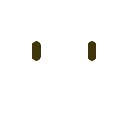

# merge-images

> Easily compose images together without messing around with canvas

[](https://travis-ci.org/lukechilds/merge-images)
[](https://coveralls.io/github/lukechilds/merge-images?branch=master)
[](https://www.npmjs.com/package/merge-images)
[](https://www.npmjs.com/package/merge-images)
[](https://github.com/sponsors/lukechilds)
[](https://lu.ke/tip/bitcoin)
[](https://lu.ke/tip/lightning)

Canvas can be kind of a pain to work with sometimes, especially if you just need a canvas context to do something relatively simple like merge some images together. `merge-images` abstracts away all the repetitive tasks into one simple function call.

Images can be overlaid on top of each other and repositioned. The function returns a Promise which resolves to a base64 data URI. Supports both the browser and Node.js.

## Install

```shell
npm install --save merge-images
```

or for quick testing:

```html
<script src="https://unpkg.com/merge-images"></script>
```

## Usage

With the following images:

`/body.png`|`/eyes.png`|`/mouth.png`
---|---|---
||

You can do:

```js
import mergeImages from 'merge-images';

mergeImages(['/body.png', '/eyes.png', '/mouth.png'])
  .then(b64 => document.querySelector('img').src = b64);
  // data:image/png;base64,iVBORw0KGgoAA...
```

And that would update the `img` element to show this image:


### Positioning

Those source png images were already the right dimensions to be overlaid on top of each other. You can also supply an array of objects with x/y co-ords to manually position each image:

```js
mergeImages([
  { src: 'body.png', x: 0, y: 0 },
  { src: 'eyes.png', x: 32, y: 0 },
  { src: 'mouth.png', x: 16, y: 0 }
])
  .then(b64 => ...);
  // data:image/png;base64,iVBORw0KGgoAA...
```

Using the same source images as above would output this:


Negative co-ords are allowed: the layer is clipped to the canvas bounds. If you'd rather treat overflowing layers as an error, pass `clip: false` in the options and the returned Promise will reject with a `RangeError` naming the offending layer index.

### Scaling

Each layer can be scaled individually with `width`/`height` properties:

```js
mergeImages([
  { src: 'body.png' },
  { src: 'eyes.png', width: 64, height: 64 }
])
  .then(b64 => ...);
```

### Opacity

The opacity can also be tweaked on each image.

```js
mergeImages([
  { src: 'body.png' },
  { src: 'eyes.png', opacity: 0.7 },
  { src: 'mouth.png', opacity: 0.3 }
])
  .then(b64 => ...);
  // data:image/png;base64,iVBORw0KGgoAA...
```


A global alpha can be applied on top of all layers with the `alpha` option. It multiplies with each layer's own `opacity`, and transparent edges are composited with consistent premultiplied-alpha source-over semantics:

```js
mergeImages(['body.png', 'eyes.png', 'mouth.png'], { alpha: 0.5 })
  .then(b64 => ...);
```

### Dimensions

By default the new image dimensions will be set to the width of the widest source image and the height of the tallest source image (taking per-layer scaling into account). You can manually specify your own dimensions in the options object:

```js
mergeImages(['/body.png', '/eyes.png', '/mouth.png'], {
  width: 128,
  height: 128
})
  .then(b64 => ...);
  // data:image/png;base64,iVBORw0KGgoAA...
```

Which will look like this:


Dimensions are validated before the canvas is created: `NaN`/`Infinity` throw a `TypeError`, and zero, negative or oversized dimensions throw a `RangeError`. The maximum allowed canvas size defaults to 32767 pixels per side and can be tuned with `options.maxCanvasSize`.

### Origin

All layer positions can be shifted at once with the `origin` option:

```js
mergeImages(['body.png', 'eyes.png', 'mouth.png'], {
  origin: { x: 10, y: 20 }
})
  .then(b64 => ...);
```

### Errors

The returned Promise rejects if anything goes wrong. Invalid positions, opacities, dimensions, quality or formats reject with a `TypeError`/`RangeError` before the canvas is created. If an image fails to load, the error tells you which source failed:

```js
mergeImages(['body.png', 'missing.png'])
  .catch(err => console.error(err.message));
  // "Couldn't load image at index 1"
```

## Node.js Usage

Usage in Node.js is the same, however you'll need to also require [node-canvas](https://github.com/Automattic/node-canvas) and pass it in via the options object.

```js
const mergeImages = require('merge-images');
const { Canvas, Image } = require('canvas');

mergeImages(['./body.png', './eyes.png', './mouth.png'], {
  Canvas: Canvas,
  Image: Image
})
  .then(b64 => ...);
  // data:image/png;base64,iVBORw0KGgoAA...
```

One thing to note is that you need to provide a valid image source for the node-canvas `Image` rather than a DOM `Image`. Notice the above example uses a file path, not a relative URL like the other examples. Check the [node-canvas docs](https://github.com/Automattic/node-canvas) for more information on valid `Image` sources. `Buffer`/`Uint8Array` sources are also accepted, and JPEG encoding errors from node-canvas' asynchronous encoder reject the returned Promise just like any other error.

## API

### mergeImages(images, [options])

Returns a Promise which resolves to a base64 data URI

#### images

Type: `array`<br>
Default: `[]`

Array of valid image sources for `new Image()` (strings, or `Buffer`/`Uint8Array` under node-canvas).<br>
Alternatively an [array of objects](#positioning) with a `src` property plus optional `x`/`y` co-ords, `opacity` (0–1) and `width`/`height` scaling. Each entry is validated before the canvas is created; layers are composited in array order no matter which order their asynchronous loads complete in, and duplicate sources are loaded into independent `Image` instances.

#### options

Type: `object`

##### options.format

Type: `string`<br>
Default: `'image/png'`

A DOMString indicating the image format.

##### options.quality

Type: `number`<br>
Default: `0.92`

A number between 0 and 1 indicating image quality if the requested format is image/jpeg or image/webp.

##### options.width

Type: `number`<br>
Default: `undefined`

The width in pixels the rendered image should be. Defaults to the width of the widest source image. Must be a finite, positive number no larger than `options.maxCanvasSize`.

##### options.height

Type: `number`<br>
Default: `undefined`

The height in pixels the rendered image should be. Defaults to the height of the tallest source image. Must be a finite, positive number no larger than `options.maxCanvasSize`.

##### options.alpha

Type: `number`<br>
Default: `1`

A global alpha between 0 and 1 applied to every layer. Multiplies with each layer's own `opacity`.

##### options.origin

Type: `object`<br>
Default: `{ x: 0, y: 0 }`

An `{ x, y }` offset added to every layer's position.

##### options.clip

Type: `boolean`<br>
Default: `true`

How layers outside the canvas bounds (e.g. negative co-ords) are handled. When `true` they are clipped to the canvas; when `false` an overflowing layer rejects the Promise with a `RangeError`.

##### options.maxCanvasSize

Type: `number`<br>
Default: `32767`

The maximum allowed canvas width/height in pixels. Larger canvases reject with a `RangeError` before the canvas is created.

##### options.Canvas

Type: `Canvas`<br>
Default: `undefined`

Canvas implementation to be used to allow usage outside of the browser. e.g Node.js with node-canvas.

##### options.Image

Type: `Image`<br>
Default: `window.Image`

Image implementation to be used. e.g Node.js with node-canvas.

##### options.crossOrigin

Type: `string`<br>
Default: `undefined`

The `crossOrigin` attribute that `Image` instances should use. e.g `Anonymous` to [support CORS-enabled images](https://developer.mozilla.org/en-US/docs/Web/HTML/CORS_enabled_image).

## License

MIT © Luke Childs
